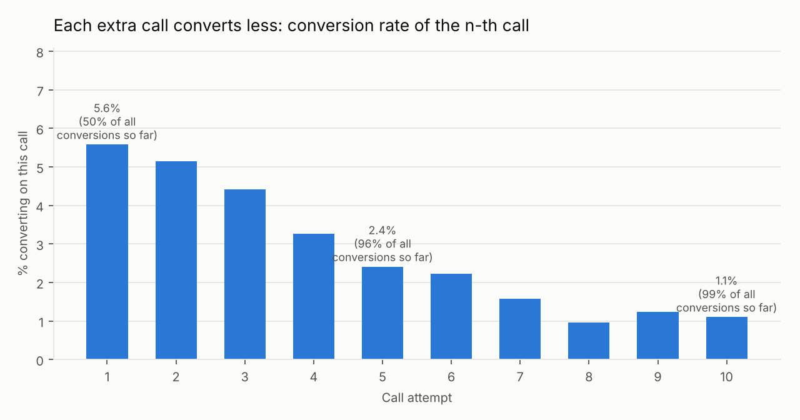
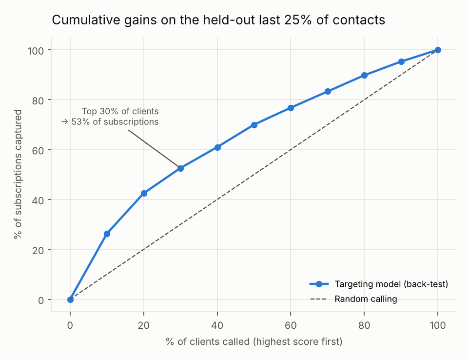

# Marketing ROI Command Center

**Where should a call-centre campaign stop calling, and whom should it call first?**

An end-to-end marketing analytics project on 41,188 real campaign contacts
(UCI Bank Marketing): Python ETL → SQLite star schema → SQL KPI layer →
scenario models → Excel workbook with live formulas → Power BI semantic model (DAX).



## Key findings

| | |
|---|---|
| **Call cap** | 96% of all subscriptions happen within 5 calls. Capping at 5 saves 15% of call attempts and keeps 96% of subscriptions. |
| **Targeting** | A client-profile model, back-tested on the *last* 25% of the timeline, captures 53% of subscriptions by calling the top 30% of the list (AUC 0.70). |
| **Re-targeting** | Clients who said yes in a previous campaign convert at 65% — 5.8× the average. |
| **Channel** | Mobile 14.7% vs landline 5.2% conversion. |
| **Reporting trap** | Averaging monthly conversion rates gives 35.4%; the correct pooled rate is 11.3%. Every measure here is a ratio of sums. |

Full write-up with method and caveats: [`reports/findings.md`](reports/findings.md)



## What's in the project

```
data/raw/                 UCI source file, unchanged (see data/README.md for citation)
config/assumptions.csv    cost-per-call & value-per-subscription inputs (editable)
src/etl.py                cleaning, data-quality log, star schema -> SQLite + CSV
sql/kpi_queries.sql       KPI layer: CTEs, window functions, segment lift, pitfall demo
src/analysis.py           call-cap scenario, targeting back-test, charts, Excel, findings
powerbi/                  Power Query (M) scripts, DAX measures, step-by-step build guide
reports/                  findings.md, KPI tables, charts, marketing_kpi_workbook.xlsx
tests/                    pipeline consistency checks (pytest)
```

### Data preparation decisions
- The source has month but no year. Rows are documented as date-ordered, so the year is
  rebuilt from month roll-overs and asserted against the documented May 2008 – Nov 2010 range.
- `unknown` is kept as a category: dropping it would silently remove 26% of clients.
- `pdays = 999` ("never contacted") becomes a flag instead of a fake 999-day value.
- Call duration is only known *after* a call, so it is used for cost but never as a model input.
- Month and macro-economic indicators were tested as model inputs and **rejected**:
  they lowered out-of-time AUC from 0.70 to 0.64 because test-period interest rates sit
  outside the training range.
- All 12 exact duplicate rows removed; every step is logged in `reports/data_quality_log.csv`.

### Excel workbook
`reports/marketing_kpi_workbook.xlsx` — change the yellow cells on **Assumptions**
(cost per call, value per subscription) and the call-cap net value, best cap
(`INDEX/MATCH`) and the targeting value columns recalculate.

### Power BI
`powerbi/BUILD_GUIDE.md` walks through the model (Date table, star schema, four what-if
parameters), 26 DAX measures (`powerbi/measures.dax`), five report pages, and
publishing/administration in Power BI Service (workspace roles, scheduled refresh, troubleshooting).

## Run it

```bash
pip install -r requirements.txt
python run_all.py          # ~10 seconds
python -m pytest -q
```

## Assumptions and limits
- The dataset has no cost or revenue fields. EUR figures come from `config/assumptions.csv`
  and are labelled as estimates everywhere they appear.
- The call-cap scenario assumes calling stops after a "yes".
- This is a bank telemarketing dataset; the methods (contact-frequency caps, propensity
  targeting, ratio-of-sums KPI design) carry over to any outbound or paid-media campaign.

## Data source
Moro, S., Rita, P., & Cortez, P. (2014). *Bank Marketing* [Dataset]. UCI Machine Learning
Repository. https://doi.org/10.24432/C5K306 — CC BY 4.0.
